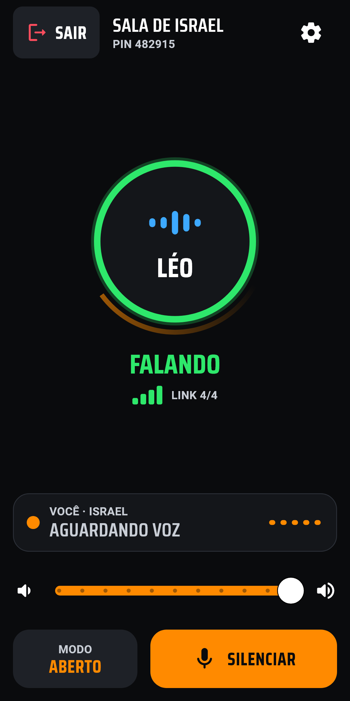
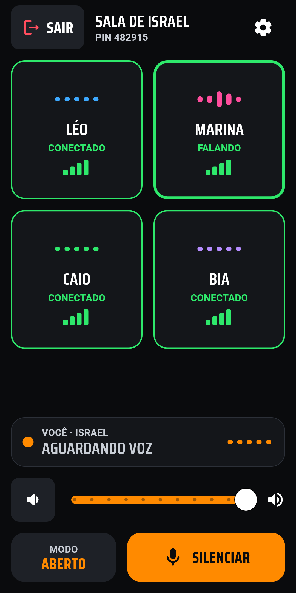
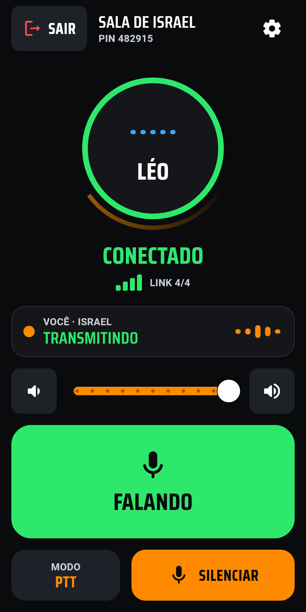

<p align="center"></p>

# Comboio

Intercomunicador por voz para motociclistas. Funciona sem internet e sem sinal de celular: cada piloto usa o próprio celular com o próprio capacete Bluetooth, e os celulares conversam por Wi-Fi local.

**Site:** https://leightonisrael.github.io/intercomunicador-v10/

<p align="center">
  
  
  
</p>

Serve para **qualquer headset Bluetooth de capacete**, de qualquer marca, inclusive os genéricos que não têm função de intercom entre unidades. O app só precisa que o headset funcione para ligações telefônicas (perfil HFP).

```
Capacete A ──Bluetooth── Celular A ══ Wi-Fi local (hotspot) ══ Celular B ──Bluetooth── Capacete B
```

## Como usar (2 pilotos)

1. Cada um pareia o capacete com o próprio celular em Ajustes > Bluetooth.
2. **Piloto A** liga o hotspot (roteador Wi-Fi) do celular, abre o Comboio e toca em **Criar sala**. A tela mostra um PIN.
3. **Piloto B** conecta no Wi-Fi do piloto A, abre o Comboio e toca na sala que aparece. Na primeira vez digita o PIN; nas seguintes entra com um toque.
4. Guardem os celulares. A conversa continua com a tela bloqueada e reconecta sozinha quando as motos se afastam e voltam.

## Onde baixar

Versão atual: **0.1.3**, enviada para revisão nas duas lojas em 27/11/2026. Os links passam a funcionar quando for aprovada.

| Loja | Link |
|---|---|
| Google Play | https://play.google.com/store/apps/details?id=com.leightonisrael.comboio |
| App Store | https://apps.apple.com/app/id6840040174 |

## Estado atual

| Parte | Situação |
|---|---|
| App Android | Testado em aparelho, inclusive só com hotspot e sem nenhuma rede. Em revisão no Google Play. |
| App iOS | Compilado e enviado pelo GitHub Actions (não há Mac). Testado pelo TestFlight. Em revisão na App Store. |
| Sinalização, PIN, retransmissão entre pilotos | Coberta por testes automáticos (`flutter test`). |
| Alcance e bateria em viagem | Ainda sem medição. Roteiro em `docs/04-testes-e-roadmap.md`. |

## Limites

- O alcance é o do Wi-Fi entre os celulares: algumas dezenas de metros. É para piloto e garupa ou motos rodando próximas.
- Durante a conversa, a música toca com qualidade de ligação (limitação do Bluetooth dos capacetes).
- Para ir mais longe: hotspot em 2,4 GHz, celular fora do bolso e quem cria a sala na moto do meio.

## Documentação

| Arquivo | Conteúdo |
|---|---|
| [docs/01-arquitetura.md](docs/01-arquitetura.md) | Decisões técnicas, pipeline de áudio, protocolo, segurança, configurações nativas |
| [docs/02-design.md](docs/02-design.md) | Design system, telas, feedback por voz e vibração |
| [docs/03-build-e-instalacao.md](docs/03-build-e-instalacao.md) | Como gerar e instalar no iPhone sem Mac e no Android |
| [docs/04-testes-e-roadmap.md](docs/04-testes-e-roadmap.md) | Testes de campo e roadmap |
| [docs/05-lojas.md](docs/05-lojas.md) | Textos e respostas para Google Play e App Store |
| [docs/privacidade.md](docs/privacidade.md) | Política de privacidade |
| [docs/index.html](docs/index.html) | Site publicado pelo GitHub Pages (pasta `docs/`) |

## Desenvolvimento

```
flutter pub get
flutter test
flutter build apk --release        # build/app/outputs/flutter-apk/app-release.apk
flutter build appbundle --release  # pacote do Google Play
```

O iOS é compilado e enviado ao TestFlight pelo workflow `ios-testflight.yml` (disparo manual). O `flutter_webrtc` fica em `third_party/` com uma correção para o hotspot do Android; ver `third_party/flutter_webrtc/COMBOIO.md`.

A chave de assinatura do Android fica em `android/app/comboio-release.jks` e `android/key.properties`. Os dois arquivos estão fora do git de propósito. **Faça backup deles**: sem a mesma chave, o Android recusa atualizar o app por cima da versão instalada.

## O que o MVP ainda não tem

Em relação ao desenho completo em `docs/`: pareamento por QR e chaves por aparelho (hoje é PIN), descoberta por Bonjour (hoje é varredura da sub-rede), distância por GPS, modo painel, frases gravadas (hoje é a voz sintetizada do sistema) e o hotspot automático no Android.
